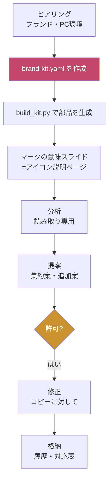

:::message
本記事は、筆者が設計したSkill（Claudeに作業手順を教えるための指示書）の解説です。Skillの設計意図と使い方を整理したもので、特定の製品仕様や論文を根拠にしたものではありません。色・企業名などのサンプル値は仮値です。
:::

## はじめに

新人研修の「開発環境構築」資料は、作った側が一番よく分かっているからこそ、読む側がつまずきやすい資料になりがちです。

- 手順スライドが20枚以上あって、どこまで進んだか分からない
- コマンドは載っているが、成功したときの画面が載っていない
- すでに環境構築済みの人も、全部の手順を読んでしまう
- 資料のデザインが、会社のブランドとずれている

これを、Claudeに手伝ってもらって直すために、2つのSkillを作りました。

| Skill名 | 役割 |
|---|---|
| `usausa-dev-env-ppt-redesign` | 環境構築PPTを、新人が**一人で**進められる形に作る・直す |
| `usausa-brand-stamp-kit` | ブランドとPC環境に合わせて、スタンプ・アイコン・図形・補足文をYAMLで作る |

## この記事の対象読者

- 新人・初心者向けの研修資料を作る研修講師・教育担当
- 環境構築手順書を保守している中堅エンジニア
- ClaudeのSkillを自分の仕事に作り込みたい人

## 全体像



ポイントは、**分析・提案までは読み取り専用で、許可を得てから直す**ことです。元の資料は上書きせず、コピー（`_v2`）に対して作業します。

## Skill 1：環境構築PPTを「一人でできる」形にする

### 基本の型：1スライド＝コマンド画面1枚＋説明

手順スライドを、次の型にそろえます。

```text
┌───────────────────────────────────────────┐
│ ステップ番号｜やること（動詞で終わるタイトル） │
├──────────────────────┬────────────────────┤
│   コマンド画面          │ ① 何をするか（1文）    │
│   スクリーンショット1枚  │ ② コマンド（コピペ可）  │
│   （赤枠で注目箇所）    │ ③ 各部分の意味         │
│                      │ ④ 成功の目印           │
│                      │ ⑤ 困ったら（付録Aへ）   │
└──────────────────────┴────────────────────┘
```

特に効くのは **④成功の目印** です。「こう出ればOK」が書いてあるだけで、新人は次に進んでよいかを自分で判断できます。

### 複数スライドを1〜2枚に集約する

連続した手順スライドは、コマンドの数と画面の変化で集約します。

| 状況 | 方法 |
|---|---|
| コマンド1つ・画面1つ | 1枚に集約 |
| コマンド2〜3個の一連の流れ | 1枚（結果画面1枚＋番号付きコマンド） |
| コマンド4個以上 | 2枚まで |
| 削除・初期化など元に戻せない操作 | **集約せず分ける** |

集約したあとは、旧→新のスライド対応表で、**手順が1つも欠けていないか**を検算します。枚数を減らすことが目的ではなく、迷わないことが目的です。

### 構築済みの人には「設定不要」を案内する

すでに環境が入っている人が、無駄な手順を実施しないための仕組みです。

1. 該当スライドのタイトル横に「構築済みならスキップ」のタグ（アイコン）を置く
2. 本文の先頭に補足を1行入れる
3. 「入っているかの確認コマンド」と、スキップしてよい出力を示す
4. アイコンの意味は、**説明ページを1枚**入れて案内する

注意点は、環境固有の設定など**必ずやる手順にはアイコンを付けない**ことです。スキップの根拠が取れない手順は `[要確認]` にします。

### つまずきを潰す1枚

事前準備の直後に、先回りの1枚を入れます。

- つまずきTOP3〜5（症状 → 原因 → 最初にやること）
- 共通の予防策（コピペする、成功の目印を確認してから次へ、画面が違ったら止まる）
- 質問テンプレ（何をした／どう出た／期待は何）

つまずきの項目は、元資料・過去の質問・公式ドキュメントから選びます。想像で作りません。材料がなければ、質問履歴の共有をお願いします。

## Skill 2：ブランドとPC環境に合わせた部品キット

アイコンやスタンプを毎回手作りすると、スライドごとに色や文言がぶれます。そこで、部品の定義を **YAML1ファイル** に集めました。

### YAMLの構成

```yaml
brand:
  palette:            # 役割（role）で管理する
    primary: "1F3A5F"
    ok:      "2E7D5B"
    warn:    "B7791F"
    danger:  "B3261E"
  fonts:              # 先頭から、PCにあるものを採用する
    jp:   ["Meiryo UI", "Yu Gothic UI", "Hiragino Sans"]
    mono: ["Cascadia Mono", "Consolas", "Menlo"]

env:                  # 受講者のPC環境
  os: windows
  shell: PowerShell
  office: "PowerPoint 365"
  fonts_available: ["Meiryo UI", "Consolas"]

stamps:
  - {id: skip, label: "構築済みならスキップ", fill: ok, icon: skip,
     meaning: "確認コマンドで〇〇と出た人は、この手順は不要"}
  - {id: win_only, label: "Windowsのみ", fill: primary, icon: info, only: [windows, wsl]}
```

（抜粋です。実際のファイルにはスタンプ・図形・補足文のひな形が入っています）

### 設計のポイント

**色は役割（role）で管理する。** スタンプや図形は色の名前ではなく `ok` `warn` のような役割で参照します。ブランドが変わったときは、paletteの書き換えだけで済みます。

**ブランド外の色・絵文字は使わない。** 絵文字やアイコンフォントは、PCの環境で見え方が変わるためです。チェックとスキップのアイコンは多角形の図形で描き、`!` `?` `i` は半角1文字にしています。

**スタンプは必ず文字つき。** 色だけで意味を伝えないためです（色の見分けにくさへの配慮にもなります）。

**環境限定のスタンプは、受講者のOSで絞る。** `only: [windows]` と書いたスタンプは、Windowsの人向けの凡例にだけ出ます。

### 生成スクリプト

```bash
python scripts/build_kit.py assets/brand-kit.yaml out.pptx
# ブランドテンプレがある場合
python scripts/build_kit.py assets/brand-kit.yaml out.pptx --template brand.pptx
```

次の3枚の見本PPTXができます。

1. このマークの意味（見方）：アイコン説明ページとして、そのまま資料に入れられる
2. 図形の使い方：赤枠・ステップ番号の丸・吹き出し・コマンド枠
3. この資料の前提：OS・シェル・Office・フォント

生成後は、PowerPointのスキーマ検証と、PDF化した画像での目視確認までを手順に含めています。

## 使ってみた手順（プロンプト例）

```text
世界一IT研修講師として、添付のPPTを分析して。
手順スライドの数、型への準拠、ブランド準拠、再現性、抜け漏れを
スライド番号つきで報告して。まだ直さないで。
```

分析結果に納得したら、次に進みます。

```text
提案どおりに修正して進めて。元ファイルは残して、コピー（_v2）に対して作業して。
修正後に、手順が欠けていないか対応表で検算して。
```

## できていること・まだできていないこと

事実と未確認の点を分けて書きます。

**確認できていること**
- 部品キットの生成スクリプトが動き、見本3枚がPowerPointのスキーマ検証に合格した
- PDF化した画像で、アイコンと配色が崩れていないことを確認した

**まだ確認できていないこと**
- 実際の企業テンプレ・既存の環境構築PPTでの通し試験
- Mac、旧版のOffice、Keynote、Google Slidesでの見た目
- サンプルのYAMLの色・企業名は仮値（実際のブランド値への置き換えが必要）

通し試験をしていないため、実際の資料に当てたときに、Skillの抜けが見つかる可能性があります。

## まとめ

- 環境構築資料は、「1スライド＝コマンド画面1枚＋説明」に型をそろえると、新人が迷いにくくなる
- 集約は、枚数を減らすためではなく、迷わないために行う。元に戻せない操作は分けておく
- 構築済みの人への案内、つまずきを潰す1枚を入れると、一人で進めやすくなる
- 部品の見た目と文言は、YAMLに集めて役割（role）で管理すると、ブランドとPC環境の変更に強くなる

今後は、実際の資料での通し試験をして、結果を反映する予定です。

:::message
🐰 うさうさ先生のひとこと：資料は「作った人が分かる」ではなく「読んだ人が迷わない」ことが大事です。まずは1スライドだけ、型に直してみましょう。
:::
